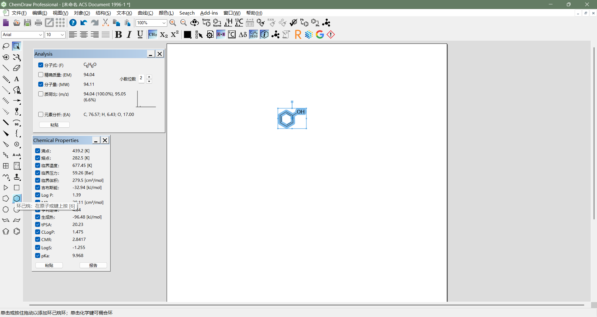
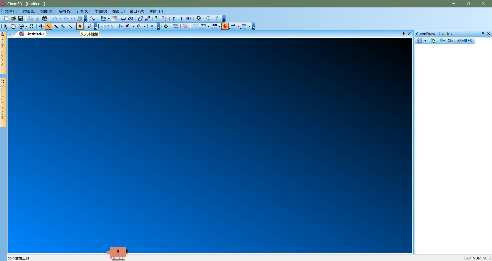

# ChemDraw 简体中文扩展补丁

> 当前版本为 [v0.2.6 预发布版](https://github.com/yangshaoxiao/chemdraw-zh-patch/releases/tag/v0.2.6)。新增只有“汉化”和“还原”两个操作的图形工具。

**本补丁免费开源，谨防付费转卖。官方下载与源码：https://github.com/yangshaoxiao/chemdraw-zh-patch 。全部 CMD 入口的窗口标题及启动、结束提示均显示免费声明和项目地址；直接运行 PowerShell 工具时也会显示来源提示。**

ChemDraw 26 简体中文汉化补丁（Windows x64）：一键汉化 / 还原，安装前做 SHA-256 校验并自动备份，覆盖 ChemDraw、Chem3D 及 ChemOffice Excel 加载项。当前翻译覆盖 87 个文件、8646 处文字替换。

*Free & open-source Simplified Chinese UI patch for ChemDraw 26 (Windows x64).*

**当前支持 ChemDraw 26.0.0.6141 x64。尚未实现整个软件全部汉化。** 没有电脑数量限制，可复制到多台已正确安装同一受支持版本的电脑使用。其他版本、Mac、缺失组件或其他补丁修改过的文件不会被视为兼容安装。

## 界面样图

以下为用户提供的当前界面样图；部分动态英文项仍保留。

ChemDraw：



Chem3D：



逐版本新增功能、修复和验证范围见 [完整更新记录](docs/CHANGELOG.md)；源码标签与发布方式见 [版本管理](docs/版本管理.md)。

## 图形工具（推荐）

从 [v0.2.6 Releases](https://github.com/yangshaoxiao/chemdraw-zh-patch/releases/tag/v0.2.6) 下载 `ChemDraw-ZH-v0.2.6.exe`，双击即可使用，无需 Python 或额外解压。

1. 点击“汉化”或“还原”，阅读准备事项并保存全部相关文档。
2. 二次确认默认选择“否”。选择“是”后才会请求关闭相关程序；管理员身份也不跳过确认。
3. 未提权时由 Windows 请求管理员授权。仅正常请求退出，不强制结束进程；若未保存文档提示尚未处理或程序仍在运行，将停止补丁操作。
4. 在主窗口查看结果。找不到安装目录时可用文件夹选择框指定目录。

兼容 Windows 10/11 x64，使用系统自带的 .NET Framework 和 Windows PowerShell。日志及备份保存在 `%LOCALAPPDATA%\ChemDrawZhPatch\runs`。图形主窗口已查看；最终二次确认和真实自动关闭流程尚未完成端到端界面复核，详见 [图形版说明](docs/图形版说明.md)。

## CMD 安装与还原

1. 下载 Releases 中的 `chemdraw-zh-patch-v0.2.6-windows-x64.zip`，完整解压到可写目录。也可以在仓库页面选择 **Code → Download ZIP**，完整解压源码包后直接运行下面的 CMD 文件。
2. 保存文档并完全退出 Excel、ChemDraw 和 Chem3D，双击 `一键安装汉化.cmd`。
3. 安装器自动查询标准安装目录与注册表。找不到安装时，按提示粘贴含 `ChemDraw.exe` 的文件夹路径。默认数据目录来自 Windows 的 ProgramData；若数据安装在其他位置，按提示填写含 `GUI` 的数据目录。
4. Windows 弹出管理员权限提示时选择“是”。显示全部文件校验通过后启动 ChemDraw。

还原：关闭 ChemDraw 和 Chem3D，运行 `一键还原英文.cmd`。只检查：运行 `检查安装环境.cmd`。

Chem3D 为可选组件：未安装时跳过，已安装时要求两个组件均为 26.0.0.6141 的已知文件状态。若 Chem3D 的菜单仍显示旧语言，可关闭软件后单独运行 `重置Chem3D菜单缓存.cmd`。此工具先导出缓存备份，再重置当前用户的菜单/工具栏布局；可能需要重新配置自定义工具栏。安装器和还原器不会自动删除这些设置。

计算驱动为可选模块：本机缺失时跳过；已安装时必须匹配已知原厂文件哈希。

普通用户不需要 Python、Git 或下载运行库；安装器使用 Windows 自带 PowerShell 5.1 和 .NET。需要使用账户具备管理员提权能力。

在受限环境或自定义安装中，可以明确指定目录：

```powershell
powershell.exe -NoProfile -ExecutionPolicy Bypass -File .\install.ps1 -Mode Install -BinPath "D:\ChemDraw\ChemDrawApplications_x64" -DataPath "D:\ChemDrawData\ChemDraw"
```

## 文件保护

安装前检查程序版本、x64 架构、每个目标文件和差分数据的 SHA-256。所有待写入文件重建并校验后，才开始修改安装目录。未知文件修改会拒绝覆盖。支持英文原版、此项目 v0.1、v0.2 和 v0.2.1 的已知文件状态；已完成的安装会跳过重复处理。

执行前状态保存在解压目录的 `backups/`，运行记录在 `logs/`。中途写入失败时尝试回滚到执行前状态。差分包包含从已知汉化状态恢复英文所需的反向差分，正常还原不需要下载原厂文件。

**不要把执行后的 backups、logs、完整 DLL 或原始软件文件上传到 GitHub。** 新发布包不包含完整的软件 EXE/DLL 或本机绝对路径。

## 覆盖与局限

替换次数：XML 2073、原生对话框 2230、字符串资源 2401、原生菜单 1108、ChemACX 插件 13、托管界面 139、计算接口界面 377、ChemOffice Excel 界面 305。数字不是独立词条数或覆盖百分比。

上述统计包含可选的 Chem3D；只安装 ChemDraw 时会跳过两个 Chem3D 文件，实际处理 78 个文件。

仍有英文：动态生成的 Search、Add-ins 等菜单和标题、部分首选项分类与表格状态、在线插件说明、模板内部名称，以及尚未确认运行时编码的自定义资源。化学数据、外部网站和 PDF 手册未全面翻译；个别短标签仍需调整布局。

真实机器先前已完成 v0.2 的启动/部分窗口检查，以及 2026-10-13 的 Analysis 初版布局检查。本次进一步修改的布局、Chem3D 窗口和新增菜单尚未做完整人工检查；v0.2.5 安装与还原采用隔离目录测试，结果见 `docs/verification_report.json`。尚未进行全部绘图、计算、打印、云服务和模块回归测试。

## 开源与开发

本项目免费提供，原创内容采用 MIT。ChemDraw 的商业授权和第三方权利保持各自范围，详见 [NOTICE.md](NOTICE.md) 和 [LICENSE](LICENSE)。

开发流程见 [docs/开发与发布.md](docs/开发与发布.md)，GitHub 上传步骤见 [docs/GitHub上传步骤.md](docs/GitHub上传步骤.md)。欢迎提交界面翻译修正、兼容版本测试及控件布局改进。

## v0.2.4 既有验证范围与已知限制

- 此前 v0.2.4 在本机已安装并校验全部 86 个文件，实际菜单中的“计算性质”和 CONFLEX、GAMESS、Gaussian、MOPAC、AutoDock“接口”名称显示中文。
- 计算窗口的控件文字完成静态资源及引用检查；没有逐一检查全部窗口，也没有运行第三方计算引擎做完整功能回归。
- `Buy Online or Learn More`、`About` 等动态子菜单项暂保留英文，后续再处理。
- Chem3D 计算菜单使用旧式 ANSI 接口，当前构建要求 Windows ANSI 代码页 936。安装器检查此要求，不兼容时停止安装；还原英文不受此限制。不修改系统区域设置。
- 没有电脑数量限制，但每台电脑都必须满足版本、文件状态及编码要求。

## ChemOffice Excel 汉化（v0.2.5）

新增 Excel 加载项 305 处界面翻译，保持原有 86 个模块字节不变。品牌名 ChemOffice、ChemFinder、SMILES、InChI 等保留。加载项的功能区 XML、命令 ID、回调、字段名称及工作簿公式不变。

安装或还原前请保存全部工作簿并完全退出 Excel；缺少加载项时自动跳过，只接受经核验的 AddIn 文件版本/哈希。3 个资源容量不足的通用按钮文字暂保留英文。当前构建的安装与实际界面检查状态见 [Excel 检查记录](docs/excel_report.json)。
